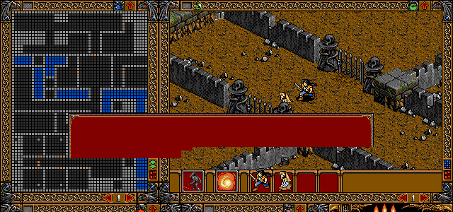
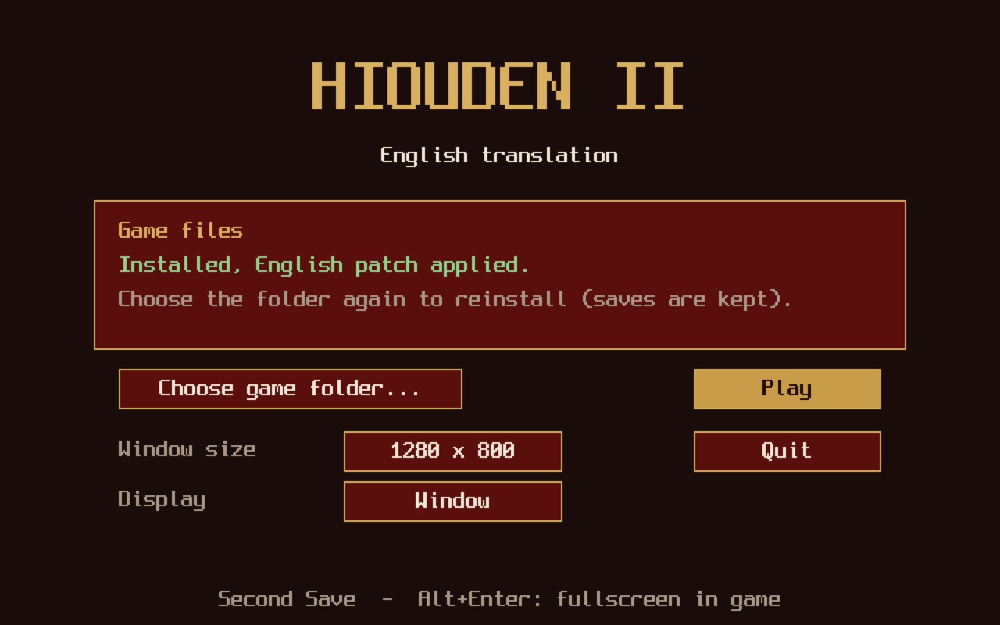
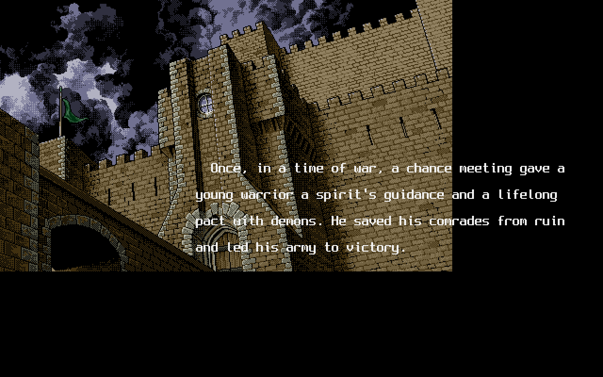
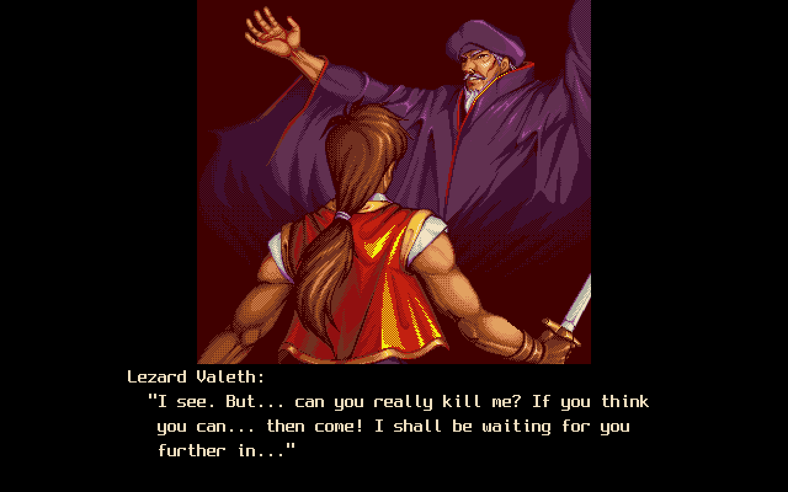
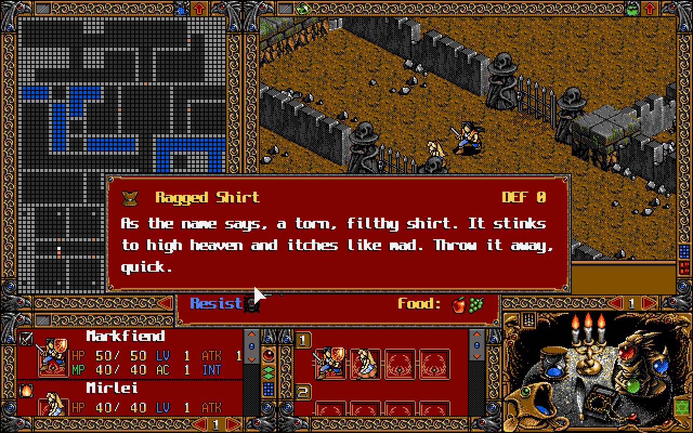

# Hiouden II: native recomp + English translation

**Hiouden II** (緋王傳Ⅱ), Wolf Team's dark real-time strategy RPG (Taiwanese DOS release by Softstar, 1995),
rebuilt to run natively on **macOS, Windows and Linux**, and translated into **English** for the first time.

No game data is included: the launcher asks for your own copy of the Taiwanese DOS release, installs it into its own
folder and applies the English patch there.



| | |
|---|---|
|  |  |
|  |  |

## Play

1. Download the build for your computer from [Releases](../../releases):
   `HioudenII-macOS.zip` (universal, macOS 11+), `HioudenII-Windows.zip` (64-bit Windows 10+) or
   `HioudenII-Linux-x86_64.tar.gz`.
2. Start **Hiouden II**. On macOS the app isn't notarized: the first time, right-click it and choose Open.
3. Click **Choose game folder...** and pick the folder of your Hiouden II install (the one with `HIO.EXE`).
   The launcher checks every file, copies the game and applies the English patch. Your folder is never changed.
4. Click **Play**. Mouse and keyboard as in the original; Alt+Enter toggles fullscreen; Esc asks whether to quit.

### First steps in the game

- **Right-click anything** for a help box saying what it does.
- **Time starts paused.** Click the blue **Hourglass** on the desk (bottom right) and your unit starts marching.
  Click it again to pause. The **Candlestick** sets the speed.
- **Fighting is automatic:** your characters attack monsters on their own. The unit window's icons set how they act
  (Action, Battle, Magic and Direction Setup, Attack Mode).
- **Save** with the **Quill**, load with the **Record Book**. **Retry** restarts the stage.

The full list is in `HOW-TO-PLAY.txt`, which comes with every download.

Saves and the patched copy live in `~/Library/Application Support/Second Save/Hiouden II/` (macOS),
`%APPDATA%\Second Save\Hiouden II\` (Windows) or `~/.local/share/Second Save/Hiouden II/` (Linux).
Playing in DOSBox instead? Each release also has `Hiouden2_EN_v1.1.zip`: per-file BPS patches and `apply.py`.

## Translation status

| Part | Status |
|---|---|
| Story: 128 event messages, 9 cutscenes, opening and ending | Translated |
| Items, spells, monsters, unit and floor names, item and spell descriptions | Translated |
| Menus, dialogs, toolbar help, in-game help pages, battle and status messages | Translated |
| Staff roll and the developers' easter-egg notes | Translated |
| Title screen and logos | No text to translate (company logos only) |
| DOS installer and sound setup (`INSTALL.EXE`, `SETUP.EXE`) | Not part of the game; not used by the recomp |

Known issues:
- The status popup's weakness element uses 2-letter names (Fi, Ic, Th, St): the game keeps them in 2-byte slots.
- Saves made with the Chinese game keep their original unit names: start a new game.
- Tested on macOS (Apple Silicon). The Windows and Linux builds are compiled and the Linux installer was tested in a
  container, but neither has been played on real hardware yet: reports welcome.

## How it works

- **Recomp:** `src/` runs the DOS program natively: an x86 interpreter for the 16-bit code, VGA, mouse, the game's
  own file loader and its FM music and voices, on SDL3. The launcher and installer are in `src/launcher.cpp` and
  `src/installer.cpp`.
- **English in a Big5 engine:** the game draws 16x15 cells. English is encoded as letter pairs: each pair gets a code
  whose glyph shows the two letters (Spleen 8x16), so a line holds 46-50 characters with no change to the text engine.
- **Patch:** widens the event-message slots, relocates the cutscene/opening/ending scripts and their pointers, and
  rebuilds the font. Details in `docs/re/`, `docs/fonts.md` and `docs/decisions.md`.

## Build from source

Needs Python 3.12+, CMake, a C++17 compiler, SDL3, and your own copy of the Taiwanese DOS release.

```sh
git clone https://github.com/second-save/hiouden-2-recomp
cd hiouden-2-recomp
# copy the game folder to: hio2/   (the build refuses other versions, see rom.sha1)
cmake -B build && cmake --build build                 # -> build/hiouden2 (recomp + launcher)
python3 tools/build.py                                # -> build/game (patched game files)
python3 -X utf8 tools/check.py                        # tests + text lint
python3 tools/release.py --version 1.0                # gates, then dist/Hiouden2_EN_v1.0 (patches)
tools/release_mac.sh                                  # also release_windows.sh, release_linux.sh (Docker)
```

| Path | What it is |
|---|---|
| `script/` | Every text block: original Chinese (`zh`) and English (`en`). Translation fixes go here. |
| `glossary.md` | Binding names, terms and style rules. |
| `tools/` | Python build chain: extract, insert, batches, QA tour, release; packaging scripts. |
| `tests/` | unittest suite (game-dependent tests skip when the game files are absent). |
| `src/` | The recomp, launcher and installer (CMake, SDL3). |
| `docs/` | Reverse-engineering notes, decisions, status, fonts. |

## Credits and licence

- Recomp, translation and tools: [Second Save](https://github.com/second-save). Tools, code and English
  translation: MIT.
- Font: Spleen by Frederic Cambus (BSD 2-Clause, `font/LICENSE-spleen`). SDL3: zlib licence.
- Hiouden II is (c) Wolf Team / Telenet Japan; Chinese edition (c) Softstar. This project is unofficial and not
  affiliated with them. The original Chinese text in `script/` is included only so the translation can be checked.
  Do not share game files or patched copies.
- Made with extensive AI assistance (Claude by Anthropic): translation, review and visual QA by AI agents, from the
  Chinese release. Corrections are very welcome.

If you enjoy this, you can support my work on Ko-fi:

[](https://ko-fi.com/second_save)
